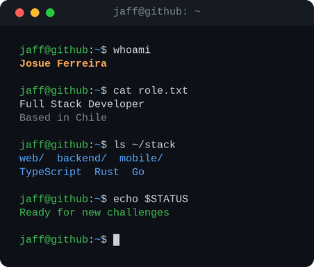

  

# Hi there 👋, I'm Josue

Full stack developer from Chile who enjoys building things end to end — web frontends,
APIs, mobile apps, desktop tools and CLIs.
Lately I've been spending most of my time with **Rust**, **Go** and **TypeScript**,
exploring systems programming, developer tooling and AI agents.

### 🔭 What I'm into

- 🌐 **Web** — Angular, React, Node.js, NestJS
- ⚙️ **Backend & APIs** — Rust (Axum, Actix-web), Go, PocketBase, Cloudflare Workers
- 📱 **Mobile** — iOS & Android apps
- 🖥️ **Desktop** — Tauri, GPUI
- 🤖 **AI agents & dev tooling** — CLIs, automation and agent orchestration
- 🗄️ **Data** — MongoDB, Firebase, PocketBase

## 🛠️ Tech Stack

**Languages**

**Frameworks & Platforms**

**Data & Infrastructure**

